# The cat's brain

The cat decides what to do with one hierarchical state machine, in
`packages/ios/Sources/Pet/Brain`. It is pure Swift with no scene in it: a scene asks it for a
frame (the state stack, a clip, where to go and where to look) and plays that with the cat's own
clips.

## Regions

Four regions run side by side.

- **Vitality**: awake, drowsy, asleep, one neighbour at a time, with a 12 s dwell. It follows the
  needs engine's sleep pressure (`rhythm·s(h) + tiredness·(1 − Rested)`): drowsy above 0.55,
  asleep when the life says so or while curled up for a nap.
- **Activity**: ten groups of steps (Idle, Explore, Rest, Groom, Eat, Play, Watch, Social, Mischief,
  React). Entering a group plays one of its scripts, such as Rest = find a nap spot, knead, curl,
  wake. When a script ends, utility chooses the next group. React is only entered by events.
- **Interaction**: Petted(zone), Held, Toy(kind), Called, Fed, FollowFinger. It overrides the
  activity while active, and the activity comes back from its **history** afterwards: a nap
  briefly petted goes on to the end it had.
- **Reflex**: blinks, ear twitches, tail flicks, breath and head tracking. Each is a pure function
  of the time and the seed on a 4 s grid, with no state.

Every move is checked against the chart (`CatStatechart.isLegal`): steps follow their scripts,
groups are entered at their entry steps, vitality never skips drowsy.

## Choosing an activity

Each group's score is

```
score = base × need × personality × time of day × room × novelty × mood × vitality
```

- **need**: `0.5 + 4·(1 − n)²` for the need the group answers (Rest → Rested, Eat → Full, Play and
  Mischief → Playful, Social → Loved), ×1.5 for the need `NeedFocus` holds.
- **personality**: `Π (1 + wᵢ·(2·tᵢ − 1))` over the traits that lean on the group.
- **time of day**: play and mischief peak at dawn and dusk; rest peaks after midday.
- **room**: no window, no Watch; Mischief needs something to nudge, a heap of clothes or a desk;
  a sunbeam (by day, under the window, in clear weather) and something soft make Rest likelier;
  a piece placed in the last day makes Explore twice as likely, and the cat inspects it.
- **novelty**: `Π (1 − 0.6·e^(−age/240 s))` over the recent episodes of the same group.
- **mood**: a happy cat plays and explores more; a low one rests more and still seeks company.
- **vitality**: asleep, only Rest; sleepy, Rest ×3 and the lively groups ×0.2.

The next group is drawn by softmax over log scores with temperature 0.35. A group in play is cut
short only by one scoring 1.6 times better, and only after its minimum dwell.

## Personality

Six traits from 0 to 1: curious, lazy, cuddly, playful, bold, vocal. They are drawn from the pet's
seed in 0.15…0.85, so every cat is someone, and two cats in the same room behave differently.
The app makes no sound: a vocal cat shows itself by perking up and seeking company.

## Determinism and sync

The brain is a pure function of the life events, the time and the seed:

- Decisions fall on a 0.25 s grid of absolute time, and every random draw comes from
  `BrainDice.roll(seed, time, salt)`, a hash with no state. However a phone got to a moment, the
  draw there is the same.
- The needs come from `PetLife.state`, sampled every 15 minutes and at each event.
- Each local day starts at 04:00 from a canonical state (asleep in its nap spot, or sitting), and
  nothing the trajectory learned crosses that line. A fresh replay from 04:00 equals a phone that
  has run all week. A full day's replay takes about 20 ms in a release build.
- `CatBrainRunner` keeps a checkpoint every 5 minutes of brain time for the last two hours. An
  event that arrives late, such as the partner's, sends it back to the checkpoint before the event
  and forward again.
- This phone's own touch is an overlay over the interaction region. It never changes the fold, so
  the phones agree again as soon as the touch ends.

Two phones agree when they hold the same events, room and seed. The room is each phone's own
choice of room, furniture and window view; a pair with different rooms sees different cats.

Between decisions, `advance(to:)` is one comparison and a frame allocates nothing.

## Rules that stay

The cat never dies, is never sick, never guilts or sulks, and is never punished. Mischief is cute:
a mug is nudged towards the edge, never off it. The touch router still decides what a touch is.

## Statechart

```mermaid
stateDiagram-v2
  state CatBrain {
    state Vitality {
      [*] --> Awake
      Awake --> Drowsy : sleep pressure
      Drowsy --> Awake : rested
      Drowsy --> Asleep : night or nap
      Asleep --> Drowsy : wakes
    }
    --
    state Activity {
      state Choose <<choice>>
      [*] --> Idle
      state Idle {
        [*] --> Sit
        [*] --> Loaf
        [*] --> LookAround
        LookAround --> Sit
        Sit --> LookAround
        Sit --> [*]
        Loaf --> [*]
        LookAround --> [*]
      }
      state Explore {
        [*] --> Wander
        [*] --> InspectFurniture
        InspectFurniture --> SniffObject
        Wander --> SniffObject
        Wander --> [*]
        SniffObject --> [*]
      }
      state Rest {
        [*] --> FindNapSpot
        Curl --> Wake
        FindNapSpot --> Curl
        FindNapSpot --> Knead
        Knead --> Curl
        Wake --> [*]
      }
      state Groom {
        [*] --> GroomPaw
        [*] --> GroomFlank
        GroomFlank --> GroomTail
        GroomPaw --> GroomFlank
        GroomPaw --> [*]
        GroomFlank --> [*]
        GroomTail --> [*]
      }
      state Eat {
        [*] --> WalkToBowl
        Eat --> LickLips
        WalkToBowl --> Eat
        LickLips --> [*]
      }
      state Play {
        [*] --> Stalk
        [*] --> Chase
        [*] --> BatObject
        [*] --> Zoomies
        Chase --> Pounce
        Pounce --> Chase
        Stalk --> Pounce
        Pounce --> [*]
        Chase --> [*]
        BatObject --> [*]
        Zoomies --> [*]
      }
      state Watch {
        [*] --> WatchWindow
        [*] --> WatchPartnerWindow
        WatchWindow --> [*]
        WatchPartnerWindow --> [*]
      }
      state Social {
        [*] --> SeekYou
        [*] --> SlowBlink
        [*] --> BringToy
        [*] --> WaitByDoor
        SeekYou --> Rub
        SeekYou --> SlowBlink
        Rub --> [*]
        SlowBlink --> [*]
        BringToy --> [*]
        WaitByDoor --> [*]
      }
      state Mischief {
        [*] --> PushItem
        [*] --> SitInCardigan
        [*] --> SitOnDesk
        PushItem --> [*]
        SitInCardigan --> [*]
        SitOnDesk --> [*]
      }
      state React {
        [*] --> Startle
        [*] --> CuriousTilt
        Startle --> [*]
        CuriousTilt --> [*]
      }
      Idle --> Choose : script ends
      Explore --> Choose : script ends
      Rest --> Choose : script ends
      Groom --> Choose : script ends
      Eat --> Choose : script ends
      Play --> Choose : script ends
      Watch --> Choose : script ends
      Social --> Choose : script ends
      Mischief --> Choose : script ends
      React --> Choose : script ends
      Choose --> Idle : utility
      Choose --> Explore : utility
      Choose --> Rest : utility
      Choose --> Groom : utility
      Choose --> Eat : utility
      Choose --> Play : utility
      Choose --> Watch : utility
      Choose --> Social : utility
      Choose --> Mischief : utility
      note right of React : any step jumps here on a note or a startle
    }
    --
    state Interaction {
      [*] --> None
      None --> Petted
      Petted --> None : ends, activity resumes from history
      None --> Held
      Held --> None : ends, activity resumes from history
      None --> Toy
      Toy --> None : ends, activity resumes from history
      None --> Called
      Called --> None : ends, activity resumes from history
      None --> Fed
      Fed --> None : ends, activity resumes from history
      None --> FollowFinger
      FollowFinger --> None : ends, activity resumes from history
    }
    --
    state Reflex {
      Blink
      EarTwitch
      TailFlick
      Breathing
      HeadTracking
    }
  }
```


