# The cat's brain

The cat decides what to do with one hierarchical state machine, in
`packages/ios/pet/Sources/Pet/Brain`. It is pure Swift with no scene in it: a scene asks it for a
frame (the state stack, a clip, where to go and where to look) and plays that with the cat's own
clips.

## Regions

Four regions run side by side.

- **Vitality**: awake, drowsy, asleep, one neighbour at a time, with a 12 s dwell. It follows the
  needs engine's sleep pressure (`rhythm·s(h) + tiredness·(1 − Rested)`): drowsy above 0.55,
  asleep when the life says so or while curled up for a nap.
- **Activity**: ten groups of steps (Idle, Explore, Rest, Groom, Eat, Play, Watch, Social, Mischief,
  React). Entering a group plays one of its scripts, such as Rest = find a nap spot, knead, curl,
  wake. When a script ends, utility chooses the next group. React is only entered by events: a
  note sends the cat to carry it to the wall (CarryNote), waking it first if it is curled up.
- **Interaction**: Petted(zone), Held, Toy(kind), Called, Fed, FollowFinger, Greeting, Batting.
  It overrides the
  activity while active, and the activity comes back from its **history** afterwards: a nap
  briefly petted goes on to the end it had.
- **Reflex**: blinks, ear twitches, tail flicks, breath and head tracking. Each is a pure function
  of the time and the seed on a 4 s grid, with no state.

Every move is checked against the chart (`CatStatechart.isLegal`): steps follow their scripts,
groups are entered at their entry steps, vitality never skips drowsy.

## Choosing an activity

Each group's score is

```
score = base × need × personality × temperament × time of day × room × novelty × mood × vitality
```

- **need**: `0.5 + 4·(1 − n)²` for the need the group answers (Rest → Rested, Eat → Full, Play and
  Mischief → Playful, Social → Loved), ×1.5 for the need `NeedFocus` holds.
- **personality**: `Π (1 + wᵢ·(2·tᵢ − 1))` over the traits that lean on the group.
- **temperament**: the type's lean towards the group (below); its need weights also scale the
  `4·(1 − n)²` part of the need term.
- **time of day**: play and mischief peak at dawn and dusk; rest peaks after midday.
- **room**: no window, no Watch; Mischief needs something to nudge, a heap of clothes or a desk;
  a sunbeam (by day, under the window, in clear weather) and something soft make Rest likelier;
  a piece placed in the last day makes Explore twice as likely, and the cat inspects it.
- **novelty**: `Π (1 − 0.6·e^(−age/240 s))` over the recent episodes of the same group.
- **mood**: a happy cat plays and explores more; a low one rests more and still seeks company.
- **vitality**: asleep, only Rest; sleepy, Rest ×3 and the lively groups ×0.2.

The next group is drawn by softmax over log scores with temperature 0.35. A group in play is cut
short only by one scoring 1.6 times better, and only after its minimum dwell.

## Personality

Six traits from 0 to 1: curious, lazy, cuddly, playful, bold, vocal. They are drawn from the pet's
seed in 0.15…0.85, so every cat is someone, and two cats in the same room behave differently.
The app makes no sound: a vocal cat shows itself by perking up and seeking company.

Experience moves them a little. At each day start the traits are the born ones moved by the last
six days of events, each weighted by `e^(−age/3 days)`: games make the cat more playful and less
lazy, pets more cuddly, notes more vocal and a little more curious, and any care a little bolder.
No trait moves more than 0.15 from where it was born, and a week without a game sends it back.

## Temperament

What kind of cat it is at heart, fixed for life. There are five types, each a corner of the
trait axes bold–shy, energetic–lazy, cuddly–independent, curious–cautious and vocal–quiet:

| Type | Leans to | Needs that weigh more | Tempo | Amplitude | Keeps from a finger | After a pet |
|---|---|---|---|---|---|---|
| Cuddler | Social ×2.6, Idle ×1.2, Mischief ×0.5 | Loved ×1.6 | 1 | 1 | 0.05 | seeks you, rubs |
| Explorer | Explore ×2.6, Watch ×1.5, Idle ×0.6 | Playful ×1.25 | 1.1 | 1.1 | 0.35 | looks around |
| Diva | Groom ×2.4, Mischief ×1.6, Watch ×1.4, Social ×0.5 | Full ×1.4, Loved ×0.75 | 0.92 | 0.85 | 0.7 | grooms |
| Sleepyhead | Rest ×2.4, Idle ×1.6, Play and Explore ×0.45 | Rested ×1.6, Playful ×0.7 | 0.78 | 0.7 | 0.3 | sleeps on |
| Clown | Play ×2.8, Mischief ×2, Idle and Rest ×0.55 | Playful ×1.6 | 1.22 | 1.3 | 0.15 | zoomies |

- **Born.** A cat's type is the one its seeded traits lean towards most, measured from an even cat
  along the way each type's heart lies. Leaning, rather than nearness, keeps the five about equally
  common. Its nature is then its seeded traits pulled 65% of the way to the type's heart, so two
  Clowns are still two cats. Drift (below) moves that nature, never the type.
- **Shown and kept.** Adoption shows each cat's type and a line about it. The seed comes from the
  pair and the cat, so both phones show the same. The one adopted is saved in the App Group
  (`cat-temperament.json`, with its seed) and never changes. A cat adopted before temperaments
  existed gets the type its traits fit, saved the first time Home opens. Nothing is synced: both
  phones work it out from the shared seed.
- **In the body.** Tempo scales the clip rate and travel speed. Amplitude scales the reflex layer
  (blinks, ear and tail flicks, breath) on a skeleton that has it. Personal space is how far short
  of a called-to spot the cat stops, in cat lengths × 1.5.
- **Seen.** Settings → Pair → Character, and the Brain debug card (type, tempo, amplitude, space,
  and each score's `k` factor).

## Upbringing

Habits the cat learns from how the two of you treat it, on top of its temperament, which never
changes. At each day start, `CatUpbringing.learned` reads the last six days of events, each
weighted by `e^(−age/2.5 days)`. Every counter is `1 − e^(−count/scale)`, so it stays between 0 and
1 and fades when the care behind it stops. Both phones fold the same events, so both raise the same
cat; the only new thing synced is the `shoo` life kind.

| Counter | From | Does |
|---|---|---|
| affection | pets (scale 14) | Social ×(1 + 0.6a), comes closer to a finger, seeks you round the hour pets usually come |
| playfulness | games (scale 8) | Play ×(1 + 0.5p), brings toys more |
| aloofness | the longest stretch with no care past a day, warmed by `e^(−cares since/4)` | Social ×(1 − 0.6l), Idle more, keeps further back |
| staying off | shoos (scale 3) | Mischief ×(1 − 0.5s), the desk and cardigan scripts ×(1 − 0.9s) |
| mealtime | meals within an hour of the same hour on 3+ days | ±20 min of it, still hungry: Eat ×3 and `walkToBowl → waitByBowl` |

- **Tricks.** Comes when called: affection ≥ 0.5 and aloofness < 0.5; then a call is never
  ignored. High-five: playfulness ≥ 0.5 and affection ≥ 0.3; then every other trick is a raised paw.
- **Shoo.** A double tap on the cat while it sits on the desk or the cardigan is a shoo, not a
  trick. It sends a `shoo` life event, and the cat startles off.
- **Seen.** Settings shows up to three habits in plain words ("Loves morning pets", "Waits for
  dinner at 8"), and Brain debug shows the raw counters and each score's `u` factor.

## Feelings: the needs you can see

`CatFeeling.of` turns the needs, sleep and temperament into one feeling, in this order: asleep,
hangry, hungry, lonely, bored, sleepy, happy, content. Hunger is how far Full sits below the low
line on its way to the floor, times the temperament's `drama` (Diva 1.5, Clown 1.2, Cuddler 1,
Explorer 0.9, Sleepyhead 0.55); at 0.5 the cat is hangry. The brain acts each feeling out:

| Feeling | What the cat does | Ends with |
| --- | --- | --- |
| Hungry | waits by the empty bowl meowing at you (`WaitByBowl`), paws at it (`PawBowl`), begs with a raised paw and follows a finger (`Beg`) | a meal from either phone: it walks to the bowl and eats at once |
| Hangry | yowls (`Yowl`), bats the mug off the seat (`KnockOff`), flops over in despair with the tail lashing (`Flop`); the eat group scores `×(1 + 3·hunger)` | the same meal |
| Lonely | sits with its back to you (`Sulk`); the first pet is ignored, the second forgiven with a head-bump (`SeekYou`, `Rub`) | pets or a note |
| Bored | zoomies, scratches the cushion (`Scratch`), attacks the yarn, brings a toy and drops it at the camera (`BringToy`, `DropToy`) | a game |
| Sleepy | yawns (`Yawn`) before it finds its spot, kneads, curls up | sleep |
| Happy | rolls onto its back (`BellyUp`), slow-blinks, kneads, and purrs (a haptic) | — |

The frame carries the feeling, a `voice` (meow, yowl, chirp) the room plays as the step starts,
with a small thought bubble of what it wants, and `purring`. The room's sound is made in code and
silent with the ringer off. When care ends a need, hearts rise over the cat.

Her needs show on Home as a ring of four arcs round her portrait (`SegmentedRing`, one arc and one
tint per need, the arc as long as the need is full) with a tag under it: "Needs", or what she asks
for while a need is low. The ring pulses once when a need turns low. A tap opens her
sheet (`MochiSheetContent`): her mood and level, a `GaugeTile` per need with its level, a word,
the care it takes and when it next runs low (`NeedForecast`, the inverse of the life's own decay,
taking her as staying awake or asleep as she is), her day and what kind of cat she is.

Her day is told from the brain's diary (`CatDiary`: seconds per activity group for each local hour
since the day began, sleep included, written as the day is folded, so a phone just launched holds
the same diary as one open since dawn) and the couple's own care today. `CatDayStory.moments` turns
the two into at most eight moments, oldest first: an hour counts for the group it mostly went to
from ten minutes up, hours in a row spent the same way are one moment, a night's sleep that runs
into the morning stays one, and what the couple did (a meal, a game, a pet, a note) keeps its own
minute and replaces the hour it explains. Sitting about and reflexes are not told. The room hands
this to the screens as `CatStatus.about` (`CatAbout`), with her type, her traits and her favourite
spot.

`CatNudge` plans one local notification for the first time in the
next day the cat would be hangry or lonely, outside 22:00–08:30, at most two a day and four hours
apart; every new event plans it again, so care from either phone moves or cancels it.

Decay is tuned so a couple who feed it twice, pet it a few times and play once a day see it
hungry, lonely and bored for a while each day, and hangry after a skipped meal: Full falls by 1/e
in 6 hours, Loved in 14, Playful in 10. Nothing falls below 0.2, and one meal brings Full from the
floor back above 0.5.

## Memory

- **Favourite spots**: seconds curled up or kneading at each kind of spot, with a minute for each
  pet there. A nap spot it is fond of is up to four times likelier, and Rest scores up to 1.3 times
  higher when one is in reach.
- **Yesterday**: a day starts with yesterday's spots at half strength. Yesterday is not carried
  from the phone's own run but rehearsed: the brain replays the previous day from its canonical
  start with no memory (about 20 ms) and keeps what that rehearsal did. So a phone that just
  launched remembers exactly what one that ran all week remembers, and anything older than two
  days is gone.
- **Who was last**: the partner whose event came last, and how long the other has been away
  (Social and Watch wait for a partner away 12 hours).
- **Recent toys**: the toys this phone's finger played with, shown in the overlay and never
  folded, as the live touch is.

## Stories, variety and habits

A script is a small story with a look, a wind-up, the act and a settle, not one clip:

| Story | Steps | When |
|---|---|---|
| Mote hunt | SpotMote → WindUp → Pounce → ShakeOff | Play; curious and playful cats |
| Stalk | Stalk → WindUp → Pounce → ShakeOff | Play |
| Dusk zoomies | WindUp → Zoomies → Skid | Play, weighted up round 19:00 and by boredom |
| Street watch | WatchWindow → TrackMover → (Chatter) → WatchWindow | Watch |
| Sunbeam wash | Bask → GroomPaw → GroomFlank | Groom, by day in clear weather, peaking at midday |
| Gift | BringToy → DropToy → SlowBlink | Social, with a toy in reach |
| Caught pushing | PushItem → GlanceBack | Mischief |
| A note arrives | PerkUp → DashToDoor → CarryNote | React, from any note |
| Heard a noise | Sit → HeardNoise → LookAround | Idle, rare |
| Tail chase | ChaseTail | Play, rare |

- **Sessions.** Play, explore, groom and social are played as a session of several scripts: after
  one ends the cat goes on with the same group (80% of the time, a different script) until the
  session's length is up (play 40-90 s, explore 25-50 s, groom 20-40 s, social 12-25 s), and only
  hunger cuts it short. So a game is half a minute or more, not one six-second script.
- **Variety.** The brain remembers the last eight scripts it played. One of the last two is
  weighted ×0.12 and one of the last five ×0.5, so the same story does not come round at once.
- **Rare things** (`CatBrain.rarities`) have a cooldown and a cap per day: a noise 40 minutes apart
  and 6 a day, a tail chase 90 minutes and 3 a day. Over their cap they are not offered.
- **Habits.** Seconds per group per local hour are kept. A new day starts with yesterday's
  (rehearsed, like the favourite spot): an hour in which the cat mostly played is up to 1.8 times
  likelier to be spent playing again. Rest is left to vitality.
- **Statistics.** `CatLifeStatisticsTests` runs 24 simulated hours for several seeds, rooms and the
  five temperaments (`CatLifeAudit`) and holds: no group over its share, at least four different
  steps (two lively) in every waking hour, no step twice running, no long dull stretch, and the rare
  things at their rate. `CAT_AUDIT=1 swift test --filter printsTheAudit` prints the full report.

## Cat observatory

Labs' brain card carries the observatory: the brain's speed (×1, ×10, ×60, a `CatClock` over the wall
clock), buttons to force a group or send an event (feed, pet, play, note, sleep), the last twenty
stretches of her life as a timeline with their lengths, and **Copy log**, which puts the clock, the
top scores and the timeline on the pasteboard for the owner to paste. The scores are worked out only
while the card is on screen; the brain itself looks four times a second (`CatDirector.thinkEvery`),
and not at all while the room is paused.

## Brain debug

**Brain debug** in Labs (The cat) puts a card on Home: the state stack, the
five best scores at the last choice with their factors (`n` need, `p` personality, `t` time, `r`
room, `b` boredom, `m` mood, `v` vitality), the last ten moves with their causes, today's traits
with arrows where experience moved them, the favourite spot, and the ×1, ×60 and ×600 clock.

## Determinism and sync

The brain is a pure function of the life events, the time and the seed:

- Decisions fall on a 0.25 s grid of absolute time, and every random draw comes from
  `BrainDice.roll(seed, time, salt)`, a hash with no state. However a phone got to a moment, the
  draw there is the same.
- The needs come from `PetLife.state`, sampled every 15 minutes and at each event.
- Each local day starts at 04:00 from a canonical state (asleep in its nap spot, or sitting), and
  nothing the trajectory learned crosses that line. A fresh replay from 04:00 equals a phone that
  has run all week. A full day's replay takes about 20 ms in a release build.
- `CatBrainRunner` keeps a checkpoint every 5 minutes of brain time for the last two hours. An
  event that arrives late, such as the partner's, sends it back to the checkpoint before the event
  and forward again.
- This phone's own touch is an overlay over the interaction region. It never changes the fold, so
  the phones agree again as soon as the touch ends.

Two phones agree when they hold the same events, room and seed. The room is each phone's own
choice of room, furniture and window view; a pair with different rooms sees different cats.

Between decisions, `advance(to:)` is one comparison and a frame allocates nothing.

## Rules that stay

The cat never dies, is never sick, never guilts or sulks, and is never punished. Mischief is cute:
a mug is nudged towards the edge, never off it. The touch router still decides what a touch is.

## In the room

The brain is always on, and so are the cat's needs: there is no switch for either. Home runs a
`CatBrainModel` beside the life model and hands each frame to the scene in `PetPlayState.brain`.
The styled rooms (`GenzCatBrain.swift`) carry it out:

- **Affordances** come from the room as it stands, after decorating: a bed, a box, a shelf,
  something soft (cardigan, hoodie, jumper), a small item (mugs, phone, candles), a rug, the window,
  the bowl and the toys. Whatever stands on the top the cat lives on is in reach. The rest can be
  looked at: a moved piece out of reach is inspected from the nearest edge. The scene reports
  them up as `PetSceneEvent.affordances` with the weather outside.
- **Body**: the cat walks (or runs, for a chase or zoomies) to where the step wants it, then plays
  the step's clip through the model's clip lookup and stand-ins. A one-shot that is shorter than
  its step repeats with a rest in its base pose (groom, knead, eat, bat), or holds its base. A
  blink or a tail flick cuts into the calm steps.
- **Gaze**: the head follows the step's gaze (the camera, out through the window, the mug it is
  about to nudge, or a slow sweep for looking around) unless a finger has it.
- Touch, games, the bowl, lifting and calls keep their own handling. The scene reports what this
  phone's touch is doing as `PetSceneEvent.touching`, which the brain shows in its interaction
  region without changing the fold.
- At ×60 or ×600 on the debug clock the body jumps to each place instead of walking, so a day
  reads as a time-lapse.

### Moments

What used to be five Labs switches is part of the brain, in the styled rooms and the Nooki room:

- **Carries the note**: a note puts the brain in React's CarryNote, and the room plays the cat
  carrying the note in its mouth to the wall or the glass and taping it up.
- **Purrs**: stroking purrs under the finger with hearts, a long pet rolls it over. It is the
  Petted interaction.
- **Bats at your finger**: only a finger *resting* near the edge (still within 8 pt for 0.35 s),
  so a quick swipe to turn the room is never batted at, and only by a cat in the mood: awake, not
  napping or eating, and `½·urgency(Playful) + ½·playful trait ≥ 0.4`. A playful cat nearly
  always is, an even one once its Playful need is below about half, a lazy one rarely. It shows
  as the Batting interaction and counts as a game. A rest lapses after 6 s.
- **Greets you**: back after 3 hours or more away, an awake cat runs up to the glass and
  headbutts it (the Greeting interaction). A sleeping cat lets it go.
- **Chases**: only when Play chooses a chase or zoomies; the room sends the cat after the lamp's
  dot of light (the yarn in the Nooki room). There is no fixed 45–90 s clock any more.

### Clips

| Step | Clip | Composed or standing in |
|---|---|---|
| Sit, find nap spot, wait by door, sit in cardigan, sit on desk | sit | |
| Loaf | loaf | sit on the low-poly cats |
| Look around | sit | head sweeps side to side |
| Wander, sniff object, inspect furniture, walk to bowl, bring toy | walk, then sniff | no carry clip |
| Knead | knead | repeats |
| Curl | lieDown, then sleep | lieDown only when it comes from standing or kneading |
| Wake | stretch | |
| Groom paw, flank, tail | groom | one groom clip for all three |
| Eat | eat | repeats |
| Lick lips | happy | no lick clip |
| Stalk | crouchWiggle | |
| Pounce | pounce | |
| Chase, zoomies | run at the clip's own speed, then perk or happy | a fast walk on the low-poly cats |
| Bat object, push item | bat | |
| Watch window | sit | head out through the glass |
| Watch partner's window | slowBlink | |
| Seek you | walk, then perk | |
| Rub | headbutt | no side rub |
| Slow blink | slowBlink | |
| Startle, curious tilt | perk | no startle or tilt |

### Clips wanted

For the Detailed and Hero cats, in order of what shows most. Loaf, run and lieDown landed in
#190 and are in use; the rest are coming.

1. **loaf**: lying with the paws tucked under, eyes open, slow breath (loop, base sleep-low).
2. **run**: a trot-to-gallop loop for chase and zoomies (walk at ×3 reads as skating).
3. **lieDown**: from standing, a turn and settling into the curl (one-shot, stand → sleep). The
   cross-fade from sit to sleep is the weakest moment of a nap.
4. **groomFlank** and **groomTail**: licking the side, and the tail held in the forepaws.
5. **lickLips**: a quick tongue flick after eating (one-shot, sit, about 1 s).
6. **startle**: an arched back and a small hop back (one-shot, stand).
7. **headTilt**: a curious tilt of the head to one side, ears forward (one-shot, sit).
8. **carry**: walking with a toy in the mouth (loop, stand), for bringing a toy.
9. **rubSide**: rubbing the cheek and flank along something (one-shot, stand).
10. **lookUp**: sitting and watching something high, the head well back (loop, sit), for birds
    and snow. The head turn stops at 0.45 rad up.
11. Additive layers on masked joints: **blinkLayer**, **earFlick**, **tailFlickLayer**, **breathe**.
    Reflexes now cut in as whole clips and only in calm steps.
12. **jumpDown** and **jumpUp** for the seat: the cat bed on the rug is out of reach until then.

## Statechart

```mermaid
stateDiagram-v2
  state CatBrain {
    state Vitality {
      [*] --> Awake
      Awake --> Drowsy : sleep pressure
      Drowsy --> Awake : rested
      Drowsy --> Asleep : night or nap
      Asleep --> Drowsy : wakes
    }
    --
    state Activity {
      state Choose <<choice>>
      [*] --> Idle
      state Idle {
        [*] --> Sit
        [*] --> Loaf
        [*] --> LookAround
        [*] --> BellyUp
        HeardNoise --> LookAround
        LookAround --> Sit
        Sit --> HeardNoise
        Sit --> LookAround
        Sit --> [*]
        Loaf --> [*]
        LookAround --> [*]
        BellyUp --> [*]
      }
      state Explore {
        [*] --> Wander
        [*] --> InspectFurniture
        InspectFurniture --> SniffObject
        SniffObject --> Wander
        Wander --> SniffObject
        Wander --> [*]
        SniffObject --> [*]
      }
      state Rest {
        [*] --> FindNapSpot
        [*] --> Yawn
        Curl --> Wake
        FindNapSpot --> Curl
        FindNapSpot --> Knead
        Knead --> Curl
        Yawn --> FindNapSpot
        Wake --> [*]
      }
      state Groom {
        [*] --> GroomPaw
        [*] --> GroomFlank
        [*] --> Bask
        Bask --> GroomPaw
        GroomFlank --> GroomTail
        GroomPaw --> Bask
        GroomPaw --> GroomFlank
        GroomPaw --> [*]
        GroomFlank --> [*]
        GroomTail --> [*]
        Bask --> [*]
      }
      state Eat {
        [*] --> WalkToBowl
        [*] --> Beg
        [*] --> Yowl
        [*] --> KnockOff
        [*] --> Flop
        Beg --> Yowl
        Eat --> LickLips
        KnockOff --> Flop
        PawBowl --> WaitByBowl
        PawBowl --> Yowl
        WalkToBowl --> Eat
        WalkToBowl --> PawBowl
        WalkToBowl --> WaitByBowl
        Yowl --> KnockOff
        LickLips --> [*]
        WaitByBowl --> [*]
        Beg --> [*]
        Yowl --> [*]
        KnockOff --> [*]
        Flop --> [*]
      }
      state Play {
        [*] --> Stalk
        [*] --> Chase
        [*] --> BatObject
        [*] --> Zoomies
        [*] --> SpotMote
        [*] --> WindUp
        [*] --> ChaseTail
        [*] --> Scratch
        Chase --> Pounce
        Pounce --> BatObject
        Pounce --> Chase
        Pounce --> ShakeOff
        SpotMote --> WindUp
        Stalk --> Pounce
        Stalk --> WindUp
        WindUp --> Pounce
        WindUp --> Zoomies
        Zoomies --> Skid
        Pounce --> [*]
        Chase --> [*]
        BatObject --> [*]
        Zoomies --> [*]
        ShakeOff --> [*]
        Skid --> [*]
        ChaseTail --> [*]
        Scratch --> [*]
      }
      state Watch {
        [*] --> WatchWindow
        [*] --> WatchPartnerWindow
        Chatter --> WatchWindow
        TrackMover --> Chatter
        TrackMover --> WatchWindow
        WatchWindow --> TrackMover
        WatchWindow --> [*]
        WatchPartnerWindow --> [*]
      }
      state Social {
        [*] --> SeekYou
        [*] --> SlowBlink
        [*] --> BringToy
        [*] --> WaitByDoor
        [*] --> Sulk
        BringToy --> DropToy
        DropToy --> SlowBlink
        SeekYou --> Rub
        SeekYou --> SlowBlink
        Rub --> [*]
        SlowBlink --> [*]
        WaitByDoor --> [*]
        DropToy --> [*]
        Sulk --> [*]
      }
      state Mischief {
        [*] --> PushItem
        [*] --> SitInCardigan
        [*] --> SitOnDesk
        PushItem --> GlanceBack
        PushItem --> [*]
        SitInCardigan --> [*]
        SitOnDesk --> [*]
        GlanceBack --> [*]
      }
      state React {
        [*] --> Startle
        [*] --> CuriousTilt
        [*] --> PerkUp
        [*] --> CarryNote
        DashToDoor --> CarryNote
        PerkUp --> DashToDoor
        Startle --> [*]
        CuriousTilt --> [*]
        PerkUp --> [*]
        CarryNote --> [*]
      }
      Idle --> Choose : script ends
      Explore --> Choose : script ends
      Rest --> Choose : script ends
      Groom --> Choose : script ends
      Eat --> Choose : script ends
      Play --> Choose : script ends
      Watch --> Choose : script ends
      Social --> Choose : script ends
      Mischief --> Choose : script ends
      React --> Choose : script ends
      Choose --> Idle : utility
      Choose --> Explore : utility
      Choose --> Rest : utility
      Choose --> Groom : utility
      Choose --> Eat : utility
      Choose --> Play : utility
      Choose --> Watch : utility
      Choose --> Social : utility
      Choose --> Mischief : utility
      note right of React : any step jumps here on a note or a startle
    }
    --
    state Interaction {
      [*] --> None
      None --> Petted
      Petted --> None : ends, activity resumes from history
      None --> Held
      Held --> None : ends, activity resumes from history
      None --> Toy
      Toy --> None : ends, activity resumes from history
      None --> Called
      Called --> None : ends, activity resumes from history
      None --> Fed
      Fed --> None : ends, activity resumes from history
      None --> FollowFinger
      FollowFinger --> None : ends, activity resumes from history
      None --> Greeting
      Greeting --> None : ends, activity resumes from history
      None --> Batting
      Batting --> None : ends, activity resumes from history
    }
    --
    state Reflex {
      Blink
      EarTwitch
      TailFlick
      Breathing
      HeadTracking
    }
  }
```


