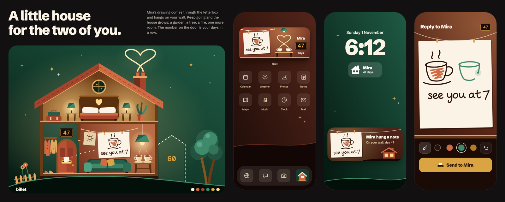
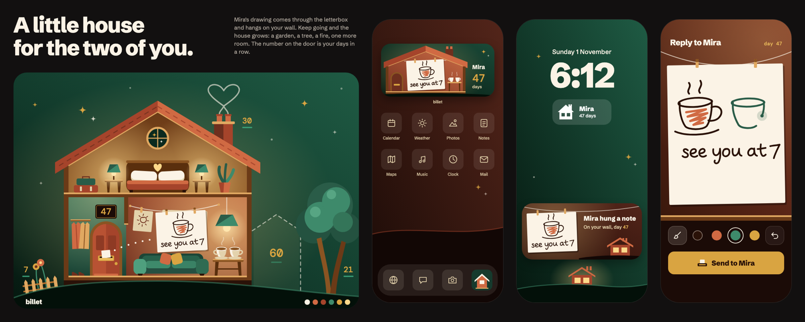

# billet design: Little House

Owner decision, 2026-11-01. The couple shares one tiny house on a night hill, seen as a warm-lit
cross-section, in flat geometric scenes. Notes come through the letterbox and hang on the
living-room wall. The streak is the house number, and the house grows with it. Everything comes in
twos, and two wisps cross to form one heart.

The board's source is [design/little-house.dc.html](design/little-house.dc.html). The code in
`packages/ios/Sources/DesignSystem` is the source of truth: where they differ, the code wins.

## Principles

- **Warm light in a dark world is the emotion.** Night is the ground, and light is the subject.
  Soft pools of light are part of the look, and they're the only gradients allowed.
- **A stranger reads love in two seconds.** The heart made by two wisps does that alone. Two pillows,
  two lamps, two coats and two cups back it up.
- **The note is the only loose thing.** The world is geometric. The drawing is hand-made, which is
  why it stands out. Never add a hand-drawn line to the art.
- **Compose, don't shrink.** Each surface gets a drawing made for its size.
- **Tender and grown-up.** Never pink gradients, confetti, cupids or anything childish.

## Colour

Interface colour is small: an evening page, two lamp-lit rungs, cream, a quiet warm grey, and gold.
Gold is the one accent. It means the primary action, the chosen thing, the house number and focus.
Clay appears in chrome only for the action that can't be undone. The rest of the clay, green, wood
and light ramps belong to the art. Every screen stands on `EveningBackground`, and every grouped
surface is a `litPanel`.

| Role | Token | Value |
| --- | --- | --- |
| Evening sky, top of the Home art | `sky` | `#0E2E2A` |
| Ground under the Home art | `meadow` | `#143B33` |
| Page | `page` | `#0C2422` |
| Foot of the page | `pageDeep` | `#081A18` |
| Lit panel | `raised` | `#402A1C` |
| Control on a panel | `raisedTop` | `#5A3C27` |
| Primary text, paper | `paper` | `#FBF3E6` |
| Secondary text on warm grounds | `paperTurned` | `#E3D2AC` |
| Quiet text | `muted` | `#C9BCA6` |
| Accent | `gold` | `#D9A441` |
| Text on gold, darkest ink | `ink` | `#2A1208` |
| House plate ground | `plate` | `#1B0B07` |

**billet is dark only.** It's a world at night, and a light theme would be a different drawing.

### Contrast floors

| Floor | Applies to | Minimum |
| --- | --- | --- |
| Text | Anything read, at any size | 4.5:1 |
| Marks | Icons, swatches, wires, lines that carry meaning | 3:1 |
| Rungs | One interface surface against the next | 1.15:1 |

`Tests/DesignSystemTests/ContrastTests.swift` holds every real pair and fails below its floor. On a
glow-lit ground a token isn't the real colour, so those tests use the worst pixel measured around
the element on the rendered board.

### Colours changed because of a measurement

| Change | Measured | Now | Why |
| --- | --- | --- | --- |
| Hall wall `#2F6B52` to `#1C4536`, its light from 0.34 to 0.12 | Gold coat 2.0:1 | 5.13:1 (clay coat 3.18:1) | The coats are a love cue and they sank into the wall. It also leaves the living room as the brightest room. |
| New `inkGold` `#B27C20` | Gold ink on paper 2.04:1 | 3.29:1 | Gold is fine on the tray and fails on paper, and paper is where ink lands. |
| Green ink `#2A5C48` to `#3E8A6B` | Swatch was `#3E8A6B`, stroke was `#2A5C48`; the darker one is 2.5:1 on a tray | 3.77:1 on paper, 4.6:1 on the tray | A swatch must show the colour it draws, and one value has to pass on both grounds. |
| Heart smoke: 62% cream to opaque `lightWarm` | 4.42:1, passed | 6.48:1 | Not a floor failure. The heart is the two-second read and it was the thinnest, faintest line in the picture. |
| Hill edge: 55% to opaque | 2.2:1 | 4.67:1 | Under the marks floor. |
| Living-room light 0.62 to 0.38 | Not a floor failure | Wire 3.31:1 at its brightest | At 0.62 clay turned salmon, close to the pink this project rules out. |
| Shoes `#6E2F1E` to `clayLit` and `woodLit` | 1.04:1 | 3.18:1 or better | They'd vanished into the wall. |
| Canvas streak: gold text on the lit wall to a `plate` | 3.26:1 | 8.51:1 | A plate brings its own ground, so it passes on any wall. This is why the streak is always a plate. |
| Live Activity numeral `#E8B95A` to `light` | Passed | Passes | One less off-ladder gold. |

Off-ladder shades on the board (`#27604A`, `#245240`, `#B85233` and others) are folded into the
named ramps in code.

## Type

| Face | Use | Licence |
| --- | --- | --- |
| Schibsted Grotesk (variable) | All text. Heavy display over a plain body. | OFL 1.1 |
| DM Mono Medium | House numbers only | OFL 1.1 |

Licence texts sit beside the fonts in `Sources/DesignSystem/Resources/Fonts`. There's no handwriting
font on purpose: a typeset imitation of a hand would undercut the one real hand in the product.

The ladder is `BilletType`: 12, 14, 17, 21, 28, 40, following Dynamic Type. Display sizes close up.
Reading sizes keep the face's own spacing.

DM Mono's zero is always slashed. None of its stylistic sets changes that (tested in render). It's
kept: it's legible and the owner chose the board with it. #35 can revisit it with the mark.

## Space and shape

Spacing is `4 / 8 / 16 / 24 / 32 / 48 / 64`. Radii belong to objects: 40 for a scene panel, 18 for a
control, 6 for a house plate, 3 for paper. Nothing else is rounded another way. The smallest target
is 44pt.

## Motion

Nothing moves yet. When it does, the one moment worth building is a note sliding through the
letterbox and rising to the wall, 300–700ms with an ease-out, and it respects Reduce Motion. No idle
loops: steam doesn't drift and stars don't twinkle.

## Scenes

Scenes are hand-built vectors drawn for this project, in `Scenes/`. A scene is an ordered list of
filled or stroked shapes (`SceneArt`), painted by one view (`SceneCanvas`), so all colour comes from
`Palette`.

- **Language:** simple silhouettes, flat planes, a two-tone lit side, slight tilts as if placed by
  hand. The ornament is a four-point sparkle.
- **One rule per surface:** a surface gets the art drawn for it, or none.

| Surface | Art |
| --- | --- |
| Large in-app panel | `HouseScene`: the whole cross-section |
| Medium widget | `RoomScene`: one recomposed room |
| Lock-screen rectangular | `LockHouseGlyph`: a heavy silhouette the system tints |
| Live Activity corner | `TinyHouseArt`: the house from outside |

### The widget rule

**The medium widget is a recomposed single room, never a scaled-down house.** It's `RoomArt`, a
separate drawing with far fewer marks than the house. Scaled into 338×158, the first board's
house hid its room behind the note and its objects became smudges. The room keeps the note on its
wire, two cups, and steam crossing into a heart, so the two-second read survives at this size. It
has a single art state. Only the number on its plate changes.

Art is a `Canvas`. Whether that archives cleanly into a real widget hasn't been tried on a device;
#31 confirms it, and can pre-render to an image if not.

### House art states

Growth is this fixed set of five, and it doesn't multiply with the streak. Each state adds to the
one before it. The number on the door keeps counting past the last state.

| State | Streak | Adds | Story |
| --- | --- | --- | --- |
| `lit` | 0–6 days | The house, two rooms lit | You've moved in |
| `garden` | 7–20 | A fence and two flowers | A week: you've started to tend it |
| `tree` | 21–29 | One tree on two trunks | Three weeks: something's rooted |
| `chimney` | 30–59 | A chimney and the heart, plus the dashed outline of the next room with its number | A month: the fire's lit, and there's a promise |
| `newRoom` | 60+ | The built room, with two chairs | Two months: you've outgrown the house |

Five is the smallest set that tells it: one state each for the four things the direction names, and
a start. "New rooms" in the brief becomes one room on purpose: another would mean drawing and
maintaining art for a streak few couples reach, and it would crowd the hill.

The state is a pure function of the current streak (`HouseStage(streak:)`), so a broken streak
returns to `lit`. Streak repair is post-launch.

Before day 30 there's no chimney, so no chimney heart. The bedroom's heart, the paired objects and
the widget's steam carry the love until then, which makes the big heart something earned.

## Notes in the world

A note arrives through the letterbox and hangs on a wire on the living-room wall, on paper held by
two pegs (`NoteCard`). The widget and Live Activity show the same sheet on the same wire, so one
object travels across every surface.

## Core components

`PrimaryButtonStyle`, `ToolButtonStyle`, `ToolIcon`, `InkSwatch`, `HousePlate`, `NoteCard`,
`ScenePanel`. `ComponentGallery` shows them all in a preview. `SceneTests` renders them to pixels
under `swift test`; set `BILLET_SNAPSHOT_DIR` to keep the PNGs.

One primary action per screen. The streak only ever appears as a `HousePlate` on screens, because a
plate is the house number and passes on any wall.

## What the first render found

The board had never been rendered. The real runtime rendered it at 2400×960, and this is what it
showed.

| Problem | Fix |
| --- | --- |
| The medium widget was the whole house shrunk, against the rule, with its room behind the note | Redrawn as one room |
| The heart was a thin 62% line, so the love read took longer than two seconds | Half as big again, opaque, in warm light |
| The tree ran off the panel's right edge and over the dashed room | Scaled down and pulled inside; dashed room narrowed |
| Milestones 7, 21, 30 and 60 with green underlines made it a labelled diagram | Removed, except 60, the one promise |
| The pillows cut off the headboard heart | Headboard raised |
| The coats read as a striped curtain | Separate coats with sleeves, collars and two lengths |
| The Live Activity was 168pt, over iOS's limit of about 160pt | 160pt |
| The lock widget was 176×76, not the real 160×72 | Resized |
| A house on the lock wallpaper repeated the Live Activity's house right below it, and billet doesn't own the wallpaper | Removed |
| The clay light turned salmon | Light reduced |
| Plus the colour failures above | See the table |

Not fixed, by decision: the dock icon on the board is a stand-in. The icon and final mark are #35.

## Rejected

- **Round 1, typographic and material concepts: candlelight letter with its seal mark, Airmail,
  Darkroom, Bare Ink.** Well made, but about stationery, not about two people. The owner rejected
  them all, and nothing from them carries over.
- **Round 2 siblings: Across the Street, Our Shelf, Bench for Two.** Same illustrated language. The
  owner chose Little House: only it has a place that can grow with the streak.
- **Scaling the house into the widget.** See the widget rule.
- **A streak-tied state for every milestone.** It multiplies art with no end.
- **A chimney from day one.** It spends the heart before it's earned, and the brief lists the
  chimney as growth.
- **Milestone numbers in the scene.** A diagram, not a picture.
- **A handwriting font.** See Type.
- **A light theme.** See Colour.
