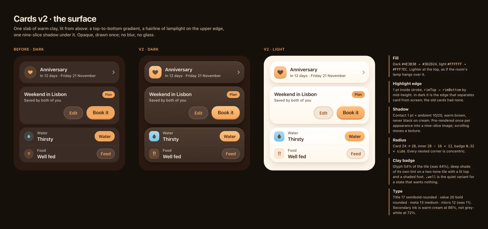
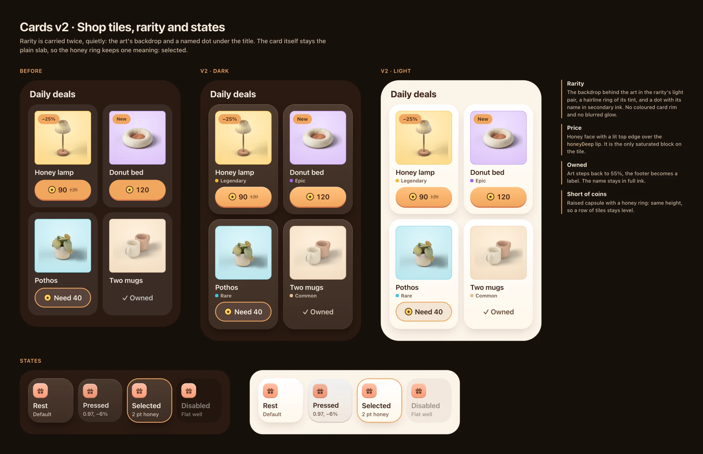
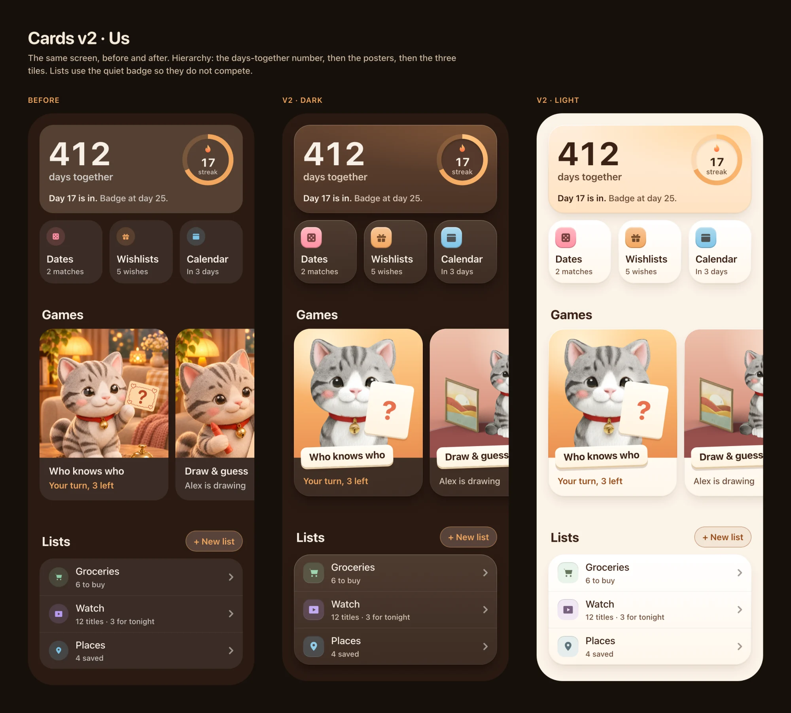
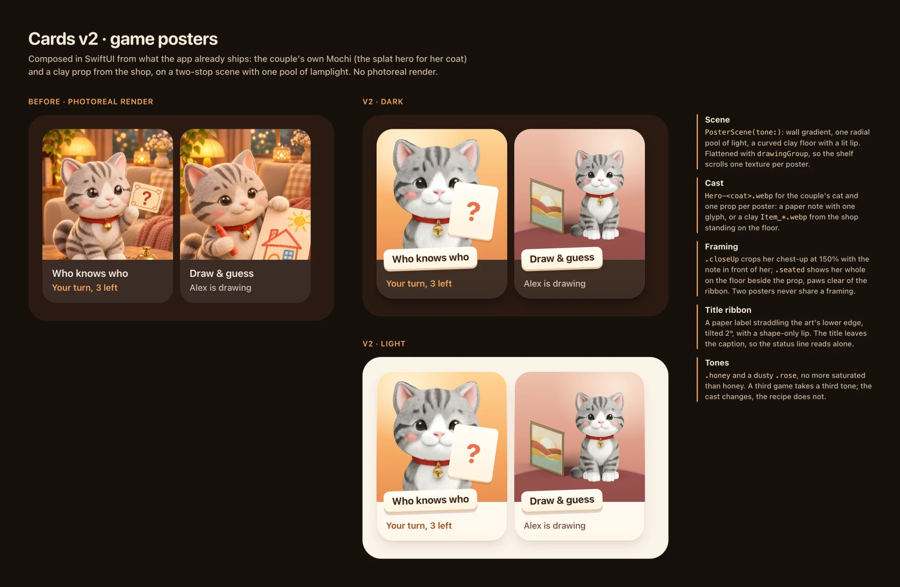

# Cards v2

The card language of the app: its surface, corners, icon badge, type, spacing, states, rarity and the
Games posters. It replaces rule 4 of [design-system.md](../design-system.md) ("No gradients, rims or shadows
on a card") and rule 12 (the icon tile). The implementation lives in `packages/ios/design`.

**Direction: lamplit clay.** Every card is a soft slab lit from above: a top-lit gradient, a hairline of
lamplight on its upper edge, a warm contact shadow under it. Icons are chunky clay tiles; posters are
composed from our own Mochi on honey-dusk scenes.

## What was wrong

The owner's phone is in dark mode. There the old card was one flat fill (`#3B2C25`) on a screen two steps
darker (`#2A1A12`), with no edge and no shadow: a heavy brown rectangle. Icons were 15 pt glyphs in pale
circles, secondary text was grey-white at 72% (it reads dim next to warm brown), the smallest text was 11 pt,
and the Games posters were photoreal renders next to a clay room.

## Constraints

- **Opaque.** No blur, no material, no glass on a card. Everything below is a gradient fill or a stroke.
- **Drawn once.** The shadow is rendered one time per appearance into a nine-slice image and stretched under
  each card, so a scroll moves textures and never runs a blur. A poster's scene is two gradients, flat shapes
  and two pictures. Nothing animates at rest; no `repeatForever`, no timeline.
- **No text under 12 pt**, and secondary text at 4.5:1 or better on every card fill (`ContrastTests`).

## Surface

| Part | Light | Dark |
| --- | --- | --- |
| Fill, top to bottom | `#FFFFFF` → `#FFF7EC` | `#4E3B30` → `#3D2D24` |
| Highlight edge, 1 pt inside | `#FFFFFF` → `#3A2114` 7% by mid-height | `#FFECD2` 24% → 4% |
| Shadow, contact | y 1, blur 1 | y 1, blur 1 |
| Shadow, ambient | y 6, blur 9, `#8A5A2B` 16% | y 6, blur 9, `#0A0400` 50% |
| Hero (`warm`) | `#FFEEDA` → `#FFE2C2`, a pool of `#FFD9A6` from the top trailing corner | `#644431` → `#4A3326`, pool `#765034` |

The light is the Living room's lamp: above, warm. In dark the highlight edge is what separates a card from
the screen; in light the shadow does, and it is brown, never black. One screen has one `warm` card.

`Ink.surface` stays as the flat colour for list rows and badges on a card.

## Radius

| Token | Was | Is | Use |
| --- | --- | --- | --- |
| `Radius.card` | 24 | 28 | every card, tile, poster, grouped section |
| `Radius.inner` | 8 | 12 | `card − CardMetrics.padding`: art wells, thumbnails |
| `Radius.sheet` | 44 | 48 | `card + Space.gutter` |
| badge | circle | `0.32 × side` | 44 → 14, 36 → 11.5 |

Corners stay concentric (`MetricsTests`). A card's radius is never more than 38% of its height, so a card of
one row (54 pt) keeps a 20 pt corner and stays a card, not a capsule. The badge is a squircle so that it nests in the card's corner and
holds a larger glyph than a circle of the same side.

## Icon badge

`RowIcon(symbol:tint:size:style:)`, two styles:

- **`.clay`**: the mark of a card or a tile (`CardHeader`, `ActionTiles`, `EmptyState`, a raised `StatusRow`).
  A tile filled with its tint, lighter at the top; a 1.5 pt inside stroke that is white at the top and the
  tint's deep shade at the foot (the lit edge and the shaded one, with no blur); the glyph at 50% of the side
  (was 44%) in the deep shade of the same tint, so it reads as pressed into the clay. The same in light and dark.
- **`.well`**: the quiet mark of a row in a list (`Row`, a quiet `StatusRow`). The tint at 20% with a hairline
  inner edge, the glyph in the tint (deepened on light surfaces).

A screen's few big things get clay; its lists stay quiet. A page of rows is not a rainbow.

## Type ladder

| Role | Style | Size, weight | Ink |
| --- | --- | --- | --- |
| Hero number | `ourioScaledFont(56)` | 56 bold rounded | `text` |
| Value | `.ourioValue` (new) | 20 bold rounded | `text` |
| Title | `.ourioHeadline` | 17 semibold rounded | `text` |
| Status | `.ourioCallout` | 15 medium | `textSecondary`, `accentText` when it asks something |
| Meta | `.ourioCaption` | 13 medium | `textSecondary` |
| Micro (chips) | `.ourioMicro` | 12 semibold rounded (was 11) | on its chip |

`textSecondary` becomes `#6B4A36` on light (7.9:1 on a card, was 6.0) and warm cream `#F3E3D0` at 86% on dark
(6.7:1 on the card's lightest stop) instead of white at 72%.

## Spacing

`CardMetrics.padding` 16 on every side; mark to words `Space.m` 12; title to meta `Space.xxs` 2 (new token for
the one gap that was a bare number); blocks inside a card `Space.m`; cards in a list `Space.m`; sections
`Space.xl` with the header `Space.m` over its content.

## States

| State | Drawing |
| --- | --- |
| Rest | fill, highlight edge, shadow |
| Pressed | `PressScaleStyle`: scale 0.97 (was 0.95), brightness −6%, 0.2 s spring |
| Selected | the highlight edge becomes a 2 pt honey ring; nothing else changes |
| Disabled | flat `Ink.disabledFill`, no edge, no shadow; labels in `Ink.disabledText` |

`cardSurface(radius:warm:state:)` and `Card(warm:state:)` take `CardState`.

## Rarity

Rarity is carried twice, quietly: the backdrop behind the art (the rarity's light pair with a hairline ring of
its tint) and a dot with the rarity's name under the title, in secondary ink (`ItemCard(tag:)`). The card
itself stays the plain slab, so a honey ring means one thing: selected. The blurred glow behind epic and
legendary art goes; it was a live shadow on every such tile.

The price is the one saturated block on a tile: the honey face is lit at the top (`honeyFace`) over the
`honeyDeep` lip.

## Us

The order the eye takes: the days-together number on the one warm card, the posters, the three tiles. The
tiles' badges are clay at 36 pt; the lists' are wells.

## Posters

`PosterCard(title, status:, emphasis:) { PosterScene(...) }`.

- **Scene.** `PosterScene(tone:framing:hero:prop:)`: a wall gradient, one radial pool of light, and for a
  seated cat a curved clay floor with a lit lip and a flat contact ellipse under her. Square.
- **Cast.** `Hero-<coat>.webp`, so the poster shows the couple's own cat, and one prop: `.note(symbol:)`, a
  paper card with one glyph, or `.clay(Image)`, a shop `Item_*.webp` standing on the floor.
- **Framing.** `.closeUp` crops her chest-up at 150% with the prop in front of her; `.seated` shows her whole
  beside the prop, paws clear of the ribbon. Two posters on a shelf never share a framing.
- **Title ribbon.** A paper label over the art's lower edge, tilted 2°, with a shape-only lip. The title
  leaves the caption, so the status line reads alone.
- **Tones.** `.honey` and a dusty `.rose`, neither more saturated than honey.

| Game | Tone | Framing | Prop |
| --- | --- | --- | --- |
| Who knows who | honey | close-up | note, `questionmark` |
| Draw & guess | rose | seated | clay, `Item_frame-landscape` |

The photoreal `WhoKnows-card` and `DrawGuess-card` images leave the shelf.

## Review

The recorded gallery pages (SE, Pro Max, the largest text size) went through the same reviewer. Taken: the
one-row capsule, the ribbon in line with the status under it, a poster's cast kept in a centred square when the
scene is wider, a warmer shadow on cream. Left for a follow-up, all older than this change: marks, chips and the
rarity dot do not grow with the text size; a `Row`'s title wraps under a long picker value; a detail line
truncates at accessibility sizes; the 2 pt honey ring is about 2:1 on cream and leans on the content to say
"selected".

The mocks went through the design reviewer. Taken: no coloured rarity rim (it collided with Selected and
put honey on a tile four times); wells for list rows; a stronger warm hero; smaller tile badges; one prop and a
different framing per poster; a dusty rose; paws clear of the ribbon. Not taken: a number as each tile's value
("2", "5", "3d"), because the status is a phrase that is not always a count ("Swipe ideas", "Nothing yet").
