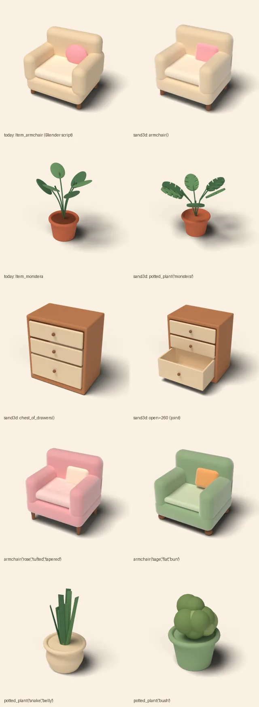
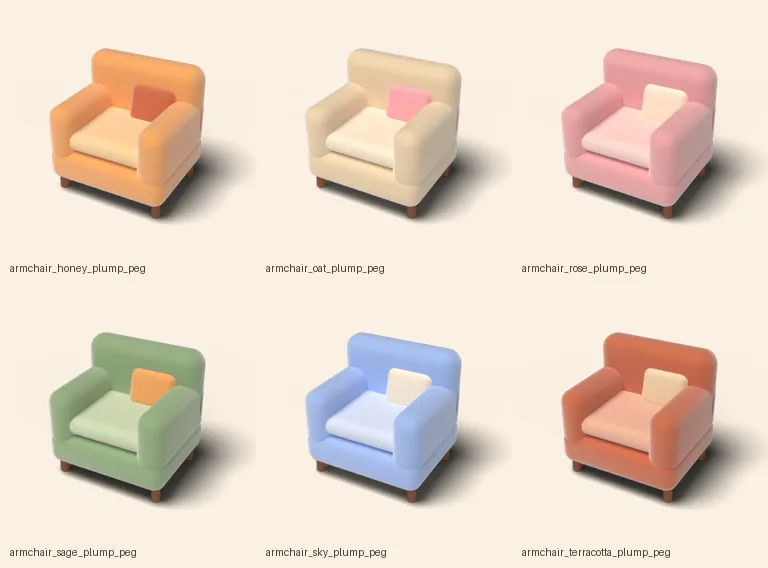

# Spike: Sand3D for room objects and shop items

Question: can [Sand3D](https://sandflow.ai/sand3d/) (github.com/Sandflow-ai/sand3d, Apache-2.0) make our room
objects and sellable shop items? It writes 3D objects as short Python programs over Blender's `bpy`, and it is
made for LLMs to write.

Programs and the pipeline: [`tools/sand3d/`](../tools/sand3d/README.md). What came of it: the armchair
colourways, a chest of drawers and a monstera ship in the app's bundle; see [In the room](#in-the-room).

**Recommendation: adapt.** Use Sand3D as an authoring layer on top of the Blender pipeline we already have, for
parametric and articulated pieces. Don't use it to replace `make_items.py` or Idol. It matches our clay look
with no extra effort, and it writes the same USDZ we ship today. Its real gains are named parameters, joints
and cheap variants. Its weak spots are organic shapes and a few export rough edges, listed below.

## What was built

| File | What |
| --- | --- |
| `billet_style.py` | Our look as a module: Ourio palette, `clay` / `cloth` / `wood` materials, bevel radii, tessellation |
| `armchair.py` | `armchair(fabric, cushion, legs)`: 7 colourways × plump/tufted/flat × peg/tapered/bun |
| `drawers.py` | `chest_of_drawers(..., open=)`: bottom drawer is a real tray on a prismatic joint, 0–300 mm |
| `plant.py` | `potted_plant(kind, pot, ...)`: monstera (slit leaves on stems), snake, bush; tapered or belly pot |
| `build.py` | program → GLB (Sand3D) → USDZ (Blender USD export, `make_items.py` settings) → optional thumbnail |
| `sweep.py` | K variants of the armchair to USDZ + thumbnails + a `variants.json` catalog fragment |
| `measure.py` | triangles, size, meshes, materials, textures of any USDZ, without Blender (`usdcat`) |

Each program is 50 to 90 lines. The style rules, taken from `apps/ios/Tools/make_items.py`, `Scene/Kit.swift`
and `Scene/Props.swift`:

- Real size, millimetres while modelling, metres in the export.
- Z up, front towards -Y, centred in X and Y with the base on z = 0, so the pivot is on the floor. The shop's
  `ShopItem.Fit` scales the item from there.
- One matte, non-metallic material per palette colour: roughness 0.82 for clay, 0.9 with the preset's sheen
  for fabric, 0.75 for painted wood. No textures. Emission only on lights.
- Every sharp edge softened: about 80–100 mm on upholstery, 60 on cushions, 12–20 on boards, 6 on trim.

## Look

- **Armchair:** almost the same as today's `Item_armchair`. The same blocks and bevels give the same read. The
  colourways work; tufting (`s3d.dent`) and tapered legs barely show at card size.
- **Chest of drawers:** reads as part of the room. The open pose comes from the joint (`open=260`), so the
  same program gives the shop still and the "cat hides here" state.
- **Plants:**
  - The monstera is close to today's in silhouette and has real slits. Its leaves are flat cut-outs, though,
    and one low leaf looks odd.
  - The snake plant's blades end flat, like celery. They need pointed tips, from a loft to a point.
  - The bush is just a clump of spheres.
  - Organic shapes take hand-tuning in either tool. Sand3D's vocabulary (boxes, revolves, lofts, booleans) is
    built for furniture and products.

Today's items and the Sand3D ones share one style module and the thumbnail rig from `make_items.py` (camera,
sun, fill, shadow catcher). Sand3D renders used 24 Cycles samples on the CPU at 512 px, not 128 GPU samples at
1024 px.

## Numbers

USDZ as exported by `build.py`, measured by `measure.py`. All are Y up, 1 m per unit and textureless, the same
as today's.

| Model | KB | Triangles | Meshes | Materials |
| --- | ---: | ---: | ---: | ---: |
| today: Item_armchair | 161 | 7,532 | 10 | 4 |
| today: Item_bookcase | 467 | 18,404 | 21 | 10 |
| today: Item_monstera | 717 | 22,456 | 15 | 4 |
| sand3d armchair, Sand3D's own tessellation | 823 | 27,832 | 10 | 4 |
| sand3d armchair, style tessellation | 120 | 3,864 | 10 | 4 |
| sand3d armchair rose / tufted / tapered | 165 | 4,866 | 10 | 4 |
| sand3d armchair sage / flat / bun | 121 | 4,184 | 10 | 4 |
| sand3d chest of drawers | 56 | 1,496 | 7 | 3 |
| sand3d monstera | 569 | 12,334 | 14 | 4 |
| sand3d snake plant, belly pot | 296 | 6,352 | 11 | 4 |
| sand3d bush | 383 | 8,918 | 16 | 4 |

Sand3D's default tessellation is a 0.05 mm chord with 24 to 64 pieces per turn, which is right for machined
parts. It gives 3.7× today's triangles. `billet_style.tessellate()` sets a 1 mm chord with 12 to 32 pieces,
about half of today's count. Every render above uses that setting.

**Frame time: not measured in the spike** (since measured, see [In the room](#in-the-room)). The app doesn't put bought furniture in the room yet. Shop models appear only on
the `ItemSheet` RealityKit stage and as card thumbnails. A local app build doesn't fit the 6-minute build lock
at the Mac's current load (60–90), Simulator frame times aren't representative, and the CI scene A/B was out of
scope.

What drives RealityKit's cost is the same or lower on every count:

- the same 7–16 entities;
- at most 4 materials;
- no textures;
- the same or fewer triangles.

So I expect no measurable difference. Measure on a device once pieces are placed in the room.

## Pipeline and cost

1. Set up once: `uv venv -p 3.13 && uv pip install sand3d` (bpy 5.2 LTS wheel; 750 MB venv). Sand3D 1.6.3,
   bpy 5.2.3. Python 3.12 is not supported (bpy ships no wheel for it).
2. `python tools/sand3d/build.py <out> [--thumbs] [name ...]`, under the build lock on the shared Mac.
   - Sand3D builds the program and writes a GLB in metres, with joints in the node extras.
   - `bpy` imports the GLB and exports USDZ with `make_items.py`'s settings: Y up, preview surfaces, linear
     colour.
3. `python tools/sand3d/sweep.py <out> --k K` writes variants. Variants are ordered colour first, so the first
   K are the most distinct.

Timing on the loaded Mac:

| Step | Time |
| --- | --- |
| Build, all 8 items, no thumbnails | 23 s |
| One thumbnail (24–16 samples, CPU, 512 px) | 4–11 s |
| Sweep of 6 armchairs with thumbnails | 27 s |

The armchair program has 7 × 3 × 3 = 63 combinations. Colour clearly makes sellable variants
(see below). Cushion and leg style are too subtle to sell on their own at card size, so treat them as
"style" options inside a colourway.

## Risks

- **Private knob:** tessellation is set through `sand3d._core`, which has no public API. It could break on a
  Sand3D update; pin the version.
- **Joint export:**
  - The GLB keeps millimetres under a 0.001 scale node.
  - The joint frame node exports as `bottom_drawer_001`, because Blender renames the clash. The drawer slides
    by moving that node.
  - RealityKit gets no joint, only a node to move. Before an app uses joints, `build.py` should bake the scale
    and give joint nodes stable names.
- **Young library:** version 1.x, renamed from sky3d recently, with a fast-moving API. It runs on bpy 5.2 /
  Python 3.13 only (or bpy 4.5 / 3.11).
- **Weak organic shapes:** plants and the cat's soft toys still need hand-tuning or Idol.
- **Licences:**
  - Sand3D is Apache-2.0.
  - bpy is GPL, but it's tooling only. Nothing from it ships in the app, and the models we make are ours.
  - The Sand3D datasets (Objaverse per-object licences, many non-commercial, and NVIDIA SimReady's own terms)
    were not used and must not be. Our programs only learn from the docs' examples and style.
- **LLM fit, untested here:** the vocabulary is compact (the API doc is ~3,600 tokens), which is the point of
  Sand3D. These programs were written by an agent from `docs/api.md` alone. Every program built on the first
  run, and only the look needed passes.

## Recommendation

**Adapt.**

Use it for:
- new parametric furniture, where a shop line is one program plus a palette sweep;
- anything with moving parts the cat uses: drawers, doors, a cat-tower hatch.

Keep:
- `make_items.py` for today's items;
- Idol for organic and painterly pieces.

To get there:
1. Pin Sand3D (done: 1.6.3, [README](../tools/sand3d/README.md)).
2. Keep the programs in `tools/sand3d` with their own README.
3. Bake the scale and name the joint nodes in the export (done in `build.py`).
4. Measure frame time with the pieces in the room (done below, in the Simulator; a phone is still to do).

## In the room

The app bundles eight Sand3D items as ordinary shop files, `Item_<id>.usdz` and a 1024 px `Item_<id>.png`:

- six armchair colourways from `armchair-colourways.json`;
- `chest`, the chest of drawers;
- `monstera-potted`, the monstera with leaf seed 3, which has no edge-on leaf at card size.

None is in the shop's catalog. Listing them is the owner's call, made in the admin
([admin.md](admin.md#sand3d-items)).

The app never puts bought furniture in the room, so a perf arm does: `-perf.pieces today|sand3d` stands three
pieces on the Room's floor, and a `cost` run's `pieces` switch takes them away and puts them back
(`OurioPerf.swift`). `today` is `Item_armchair`, `Item_bookcase` and `Item_monstera`. `sand3d` is
`Item_armchair-meadow`, `Item_chest` and `Item_monstera-potted`. Each is fitted the way the shop fits it and lit
like the room's own furniture.

| Three pieces | Triangles | USDZ KB | Meshes | Materials |
| --- | ---: | ---: | ---: | ---: |
| today | 48,392 | 1,345 | 46 | 18 |
| sand3d | 20,874 | 892 | 31 | 11 |

Frame time, one local Release build in the Simulator (iPhone 17 Pro, iOS 27.2). Four `cost` runs per arm,
alternating `today` and `sand3d`. Medians, with the range in brackets.

| Arm | Still p95 with / without (ms) | Still fps with / without | Orbit p95 with / without (ms) |
| --- | --- | --- | --- |
| today | 38.2 (35.1–40.6) / 34.8 (33.9–36.1) | 45.4 / 49.1 | 36.5 / 36.6 |
| sand3d | 35.4 (35.1–69.9) / 35.8 (34.5–40.0) | 48.1 / 46.8 | 36.4 / 37.7 |

p50 was 16.7 ms in every case. The Mac's load average was 170 to 340 during the runs, so the ranges overlap and
neither arm's cost can be told from noise. The Sand3D pieces cost no more than today's: they have 43% of the
triangles and fewer meshes and materials. A phone measurement is still to do.
